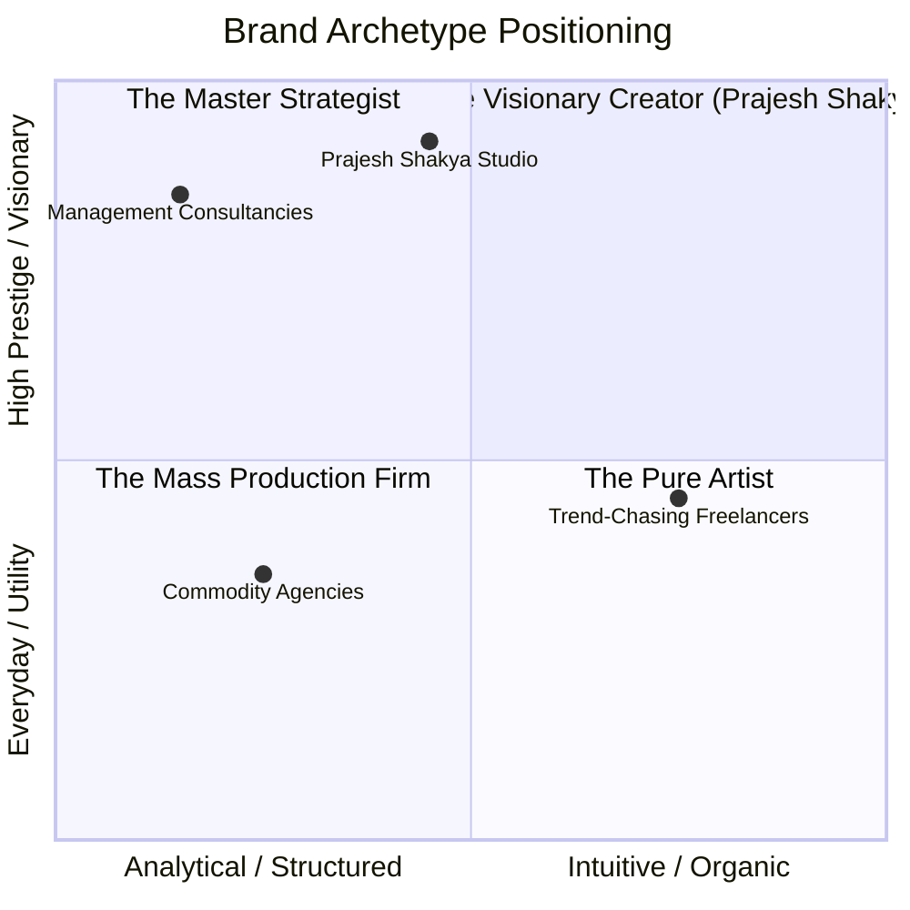
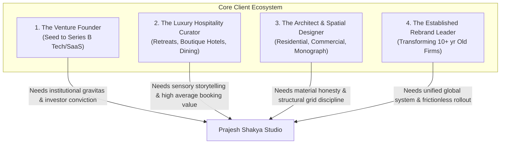

# Prajesh Shakya — Brand DNA (Strategic Identity Manual)

> **"Your logo is not your brand. Build a point of view first. Then give it a face."**  
> *A comprehensive strategic blueprint codifying the core purpose, brand essence, archetype, tone of voice, visual DNA, and positioning architecture for Prajesh Shakya Studio.*

---

## 1. Executive Brand Profile

| Dimension | Specification |
| :--- | :--- |
| **Studio Name** | Prajesh Shakya (Prajesh Shakya Studio) |
| **Monogram Mark** | Interlocking 45° Isometric Continuous PS Monogram |
| **Principal** | Prajesh Shakya |
| **Discipline** | Brand Strategy, Visual Identity Systems, Creative Direction, Digital Craft |
| **Canonical URL** | [shakyaprajesh.com.np](https://www.shakyaprajesh.com.np) |
| **Contact Email** | `prajeshshakya@gmail.com` |
| **Headquarters & Scope**| Kathmandu, Nepal — Operating Globally (Australia, US, UK, Europe, Singapore) |
| **Track Record** | 6+ Years Industry Experience · 80+ Completed Projects · 7+ Countries Spanned |
| **Core Offering Tiers** | Foundation (3–4 wks) · Identity (6–8 wks) · System (10–12 wks) |
| **PDF Monograph** | [`Prajesh-Shakya-Brand-DNA.pdf`](./Prajesh-Shakya-Brand-DNA.pdf) (A4 5-Page Monograph) |
| **API PDF Route** | `/api/brand-dna/pdf` |

---

## 2. Core Purpose, Vision & Mission

```
               ┌────────────────────────────────────────────────────────┐
               │                        PURPOSE                         │
               │ To liberate ambitious businesses from trend-chasing    │
               │ decoration through strategic truth and visual dignity. │
               └───────────────────────────┬────────────────────────────┘
                                           │
                                           ▼
               ┌────────────────────────────────────────────────────────┐
               │                         VISION                         │
               │ A commercial landscape where brands outlast decades,   │
               │ where strategy and digital craft operate as one.       │
               └───────────────────────────┬────────────────────────────┘
                                           │
                                           ▼
               ┌────────────────────────────────────────────────────────┐
               │                        MISSION                         │
               │ To excavate authentic competitive distinction, codify  │
               │ strategic moats, and forge enduring visual identities. │
               └────────────────────────────────────────────────────────┘
```

### The Purpose (Why We Exist)
In an era dominated by hyper-accelerated aesthetic cycles, Canva templates, and AI-generated homogenization, most businesses mistake decorative styling for brand equity. They spend fortunes repainting surfaces while their value proposition remains indistinct.  
**Prajesh Shakya exists to restore gravitas, intellectual discipline, and enduring visual dignity to brand building.** Every project begins with rigorous enquiry to unearth what is authentically true, creating identities that command authority without raising their voice.

### The Vision (The Future We Seek)
A world where ambitious founders, independent institutions, and cultural enterprises do not need to choose between commercial efficacy and artistic distinction. We envision brands built like mid-century architecture: structurally sound, materially honest, and increasingly revered with age.

### The Mission (What We Do Daily)
To partner with visionary leaders, emerging startups, and boutique enterprises to diagnose market vulnerabilities, clarify strategic positioning, and construct cohesive visual identity systems, tactile collateral, and digital environments that convert perception into commercial leverage.

---

## 3. Brand Essence & Positioning Architecture

### Brand Essence
> **"Quiet Editorial Confidence"**

We do not shout. We do not employ synthetic neon accents, hyper-saturated gradients, or frantic micro-interactions to demand attention. The confidence of Prajesh Shakya is expressed through deliberate negative space, razor-sharp 1px hairlines, classical typography, and unwavering adherence to truth.

### The Strategic Positioning Statement
```
FOR:        Ambitious founders, boutique hospitality leaders, architects, venture funds,
            and discerning businesses who refuse to be commoditized;
WHO NEED:   A distinctive brand identity that commands premium pricing, institutional trust,
            and immediate category recognition;
PRAJEESH:   Is the brand identity advisory and creative studio
THAT:       Integrates high-rigor market strategy with gallery-grade editorial craft;
UNLIKE:     Traditional bloated agencies (slow, junior-heavy, jargon-ridden)
            or commoditized freelancer marketplaces (decorative, superficial, trend-led);
OUR PROOF:  6+ years of specialized practice, 80+ transformed brands, proven 45%+ booking
            surges, and an open, transparent design system built for longevity.
```

### The Three Strategic Filters (The Acid Tests)
Before any identity, wordmark, or palette is approved for a client or our own studio, it must pass three non-negotiable filters:

1. **The Sacrifice Test**: Strategy is defined by what you deliberately decline to be. If a brand claims to be "luxurious yet budget-friendly, playful yet corporate, agile yet monolithic," it has made zero strategic choices. We force explicit sacrifice.
2. **The Category Test**: Can the client describe their unique value proposition in one sentence without relying on empty clichés like "innovative," "passionate," "seamless," or "next-gen"?
3. **The Distinctiveness Test**: If you strip away the logo mark entirely, do the typography, layout rhythm, color temperature, and voice immediately identify the brand?

---

## 4. Brand Archetype & Psychological Profile



### Primary Archetype: The Creator (60%)
- **Motto**: *"If it can be imagined, it can be crafted with precision."*
- **Core Drive**: To give physical and digital form to abstract vision; to manifest aesthetic coherence, timeless proportion, and artisanal dignity.
- **Shadow to Avoid**: Perfectionism that stalls execution or design for designer awards rather than business impact.

### Secondary Archetype: The Sage / The Architect (40%)
- **Motto**: *"Truth over trend. Clarity over novelty."*
- **Core Drive**: To understand fundamental structural principles, human psychology, and market dynamics before picking up a pencil or laying a pixel.
- **Role in Client Relationships**: An objective, strategic counsel who diagnoses before prescribing.

---

## 5. Personality Spectrum & Brand Character

| Dimension | Where We Sit | How It Manifests in Practice |
| :--- | :--- | :--- |
| **Volume** | **Quiet & Deliberate** (9/10) | Generous margins, whispered kickers, parchment backgrounds over harsh pure white, no strobe effects. |
| **Intellect** | **Strategic & Analytical** (9/10) | Rooted in positioning theses, competitor mapping, and economic reality rather than personal whim. |
| **Craft** | **Tactile & Museum-Grade** (10/10) | Obsessive kerning, calibrated 45° isometric geometry, WCAG AAA contrast ratios, fine print paper specs. |
| **Demeanor** | **Warm, Direct, Partner** (8/10) | Transparent pricing tables, zero hidden agency fees, direct principal communication without account managers. |
| **Pacing** | **Measured & Rhythmic** (8/10) | Physics-based cubic-bezier easing; instant cuts for reduced motion; no gratuitous bouncing. |

---

## 6. Verbal Identity & Tone of Voice

### Voice Principles

#### 1. Quiet Editorial Conviction
Speak with the quiet authority of an established monograph publisher. Avoid superlatives, exclamation points, and hyperbole. Let the results and typographic precision make the statement.
- *Avoid*: "We build super insanely cool, next-generation hype brands that crush your competitors!!!"
- *Adopt*: "We construct enduring brand systems that command category authority and compound in value over time."

#### 2. Lucid Simplicity (No Corporate Jargon)
Strip away the hollow jargon that agencies hide behind. Use plain, elegant, and definitive language.
- *Avoid*: "Synergizing cross-functional paradigm shifts to maximize omni-channel engagement touchpoints."
- *Adopt*: "Aligning your strategic message across physical print, digital portals, and customer interactions."

#### 3. Candid Architectural Honesty
Be willing to tell the client what will not work. A true strategic partner protects the client's business from expensive mistakes.
- *Avoid*: "Whatever you like is fine with us, customer is always right!"
- *Adopt*: "Adding three competing accent colors will dilute the brand's perceived value in the luxury hospitality sector. Here is why we recommend retaining monochromatic restraint."

#### 4. Materiality & Sensory Depth
Use words that evoke craftsmanship, texture, architecture, and enduring materials.
- *Key vocabulary*: *Parchment, obsidian, hairline, cadence, architectural, tactile, proportion, ballast, clarity, restraint, legacy, monograph.*

### Tone Matrix Across Touchpoints

| Channel / Context | Tone Modulation | Primary Objective |
| :--- | :--- | :--- |
| **Public Portfolio & Hero** | Poetic, architectural, unapologetically confident. | Establish studio prestige and filter for serious clients. |
| **Kinetic Hero Interaction** | Slot-anchored typographic truth, tactile physics. | Demonstrate living digital craft and typographic depth. |
| **Intake Funnel (`/start`)** | Diagnostic, structured, encouraging, transparent. | Qualify client scope, calculate investment tiers, capture intent. |
| **Case Studies (`/projects`)** | Objective, analytical, monograph-style reportage. | Prove ROI, demonstrate design thinking, credit collaborators. |
| **Client Proposals & Invoices** | Courteous, scrupulously transparent, unambiguous. | Eliminate friction, outline exact milestones, respect financial trust. |
| **Client Portals (`/m/[token]`)** | Collaborative, focused, encouraging targeted critique. | Guide client feedback to strategic objectives rather than subjective bias. |
| **AI Strategist ("Praj")** | Consultative, sharp, conversational, lead-qualifying. | Educate visitor, uncover project scope, route to `/start`. |
| **Studio Notes & Essays** | Thought-provoking, contrarian, intellectually generous. | Shape industry discourse and articulate design philosophy. |

---

## 7. The Five Core Brand Pillars

```
┌─────────────────────────────────────────────────────────────────────────────┐
│                       THE FIVE PILLARS OF PRAJESH SHAKYA                    │
├──────────────┬──────────────┬──────────────┬──────────────┬─────────────────┤
│   PILLAR 1   │   PILLAR 2   │   PILLAR 3   │   PILLAR 4   │    PILLAR 5     │
│   Strategy   │  Meaningful  │  Typographic │   Enduring   │      True       │
│    First     │  Simplicity  │    Truth     │  Longevity   │   Partnership   │
├──────────────┼──────────────┼──────────────┼──────────────┼─────────────────┤
│ No vectors   │ Removing the │ Historical   │ Designing    │ Direct access   │
│ without market│ superfluous  │ serif depth  │ against      │ to principal;   │
│ calibration  │ to amplify   │ paired with  │ fleeting     │ zero junior     │
│ & rationale. │ core value.  │ Swiss mono.  │ micro-trends.│ delegation.     │
└──────────────┴──────────────┴──────────────┴──────────────┴─────────────────┘
```

### 1. Strategy First
Design without strategy is superficial decoration. Every mark, color swatch, and structural grid is informed by competitive whitespace, audience psychographics, and business economics.

### 2. Meaningful Simplicity
Perfection is attained not when there is nothing left to add, but when there is nothing left to take away. We strip away the ornamental noise so the authentic character of the brand can resonate without obstruction.

### 3. Typographic Truth & Digital Craft
Typography is the voice of the mind made visible. By pairing the literary grace of **Instrument Serif** with the modernist utility of **Instrument Sans** and the operational rigor of **Geist Mono**, we build visual hierarchies that convey intellectual substance.

### 4. Enduring Longevity
Trends age like milk; enduring systems age like granite. We build brands meant to look as commanding ten years from now as they do on launch day.

### 5. True Partnership & Radical Transparency
Clients never speak to an account coordinator or junior intern. They work directly with Prajesh Shakya. We provide transparent package pricing, clear milestone deliverables, and honest guidance at every phase.

---

## 8. Target Audience Personas & Empathy Matrix



### Profile 1: The Tech / Venture Founder (e.g., *Atlas Ventures*)
- **Psychographic**: Visionary, analytical, time-poor, values clarity and speed without compromising quality.
- **Core Frustration**: "Our product is revolutionary, but our branding looks like a cookie-cutter template. Investors and enterprise buyers treat us like a hobby project."
- **Desired Transformation**: An identity with institutional weight, refined data visualization, and investor-ready collateral that unlocks higher valuations.
- **Recommended Tier**: **Identity** or **System** Package.

### Profile 2: The Mindful Luxury / Hospitality Operator (e.g., *Aurora Wellness*)
- **Psychographic**: Sensualist, design-conscious, obsessive about customer experience and ambiance.
- **Core Frustration**: "Our physical retreat is breathtaking, but our digital presence feels cold and disconnected. Guests can't feel the magic before booking."
- **Desired Transformation**: Earthy, tactile color schemes, bespoke wordmarks, custom stationery, and packaging that guests keep as cherished mementos.
- **Recommended Tier**: **Identity** Package + Custom Packaging Add-ons.

### Profile 3: The Architecture & Spatial Principal (e.g., *Meridian Architects*)
- **Psychographic**: Rigorous, material-obsessed, minimalist, skeptical of fluffy marketing.
- **Core Frustration**: "Graphic designers keep giving us trendy gradients that clash with our concrete and blackened steel buildings."
- **Desired Transformation**: Structural grid systems, raw unbleached card stocks, laser-etched signage guidelines, and monograph books that rival Phaidon.
- **Recommended Tier**: **System** Package.

---

## 9. Visual Identity DNA (Bridging Strategy to Execution)

The visual manifestation of the brand is detailed in the companion [DESIGN_SYSTEM.md](./DESIGN_SYSTEM.md). Below is the strategic codification of our aesthetic tokens:

### Palette Semiotics
- **Ground (`#F5F5F3`)**: Parchment canvas. Conveys physical paper, warmth, humanism, and gallery wall serenity. Replaces sterile `#FFFFFF`.
- **Ink (`#1B1A16`)**: Deep obsidian carbon. Conveys permanence, intellectual authority, and high-contrast readability (14.2:1 AAA).
- **Ink Soft (`#45443D`)**: Charcoal half-tone. Prevents eye fatigue in long-form editorial discourse.
- **Hairline (`#D9D7CD`)**: Architectural boundary. Replaces fuzzy, dishonest dropped shadows with pure spatial precision.

### The PS Monogram Geometry
Constructed upon a rigorous **45° isometric diamond grid**, the monogram represents the uninterrupted continuum between **Positioning ('P')** and **System ('S')**. Its continuous uniform stroke symbolizes cohesion: strategy and execution flowing in a single, unbroken loop.

---

## 10. The Client Experience Journey & Studio Rituals

```
[ Phase 1: Immersion & Diagnosis ]
   └── 30-Min Discovery Call · Questionnaire · Competitor Landscape Audit
[ Phase 2: The Strategic Platform ]
   └── Brand Platform Monograph · Audience Archetype · Positioning Thesis
[ Phase 3: Visual Identity Exploration ]
   └── 2–3 Divergent Holistic Concepts · Interactive Moodboards (/m/[token])
[ Phase 4: Refinement & Systematization ]
   └── Collaborative Pinpoint Feedback · Token Calibration · Application Tests
[ Phase 5: Handover & Guardianship ]
   └── Vector Suite Delivery · 25–40pg Brand Guidelines · Launch Kit · 30-Day Support
```

### Signature Studio Rituals:
1. **The Transparent Scope**: Fixed-scope quotes with clear inclusions, currency flexibility (NPR, AUD, USD), and no surprise charges.
2. **The Zero-Friction Moodboard (`/m/[token]`)**: Clients receive private tokenized links requiring zero logins to review, annotate, and approve milestones in real time.
3. **The Launch Kit**: Every brand identity includes a comprehensive vector export pack (SVG, EPS, PDF, Retina PNG, WebP) structured in an intuitive, self-explanatory directory hierarchy.
4. **The 30-Day Guardianship**: Following brand launch, Prajesh remains available to review real-world vendor outputs, press proofs, and early marketing collateral.

---

## 11. Strategic Anti-Patterns (What We Deliberately Reject)

To maintain our brand equity, we uphold strict operational boundaries:

| Anti-Pattern | Why We Reject It | Our Counter-Commitment |
| :--- | :--- | :--- |
| **The "Logo Farm" Quickie** | Logos divorced from strategy fail to build equity and quickly get replaced. | We never sell raw logos in isolation; every project includes strategy and a complete identity suite. |
| **Trend-Chasing Mimicry** | Y2K bubble letters, glassmorphism, or acid neo-brutalism expire within 12 months. | We ground every visual system in timeless classical typography and geometric fundamentals. |
| **Agency Overhead Markups** | Charging \$40,000 to cover senior partner salaries while having junior interns do the actual work. | Direct, uncompromised principal-level design and consulting at honest, transparent rates. |
| **Subjective "Make It Pop"** | Vague, emotional feedback that wastes weeks in revision loops. | Clear strategic criteria agreed upon in Phase 1 against which all visual solutions are objectively evaluated. |
| **Artificial Drop Shadows** | Synthetic blur effects that simulate fake digital depth. | Crisp 1px hairline rules, proportional spacing, and typographic weight create authentic structural depth. |

---

## 12. Living Brand Checklist

For every communication, project, or asset produced under the Prajesh Shakya brand:

- [ ] Does it lead with a clear strategic perspective?
- [ ] Is it typeset in Instrument Serif, Instrument Sans, or Geist Mono?
- [ ] Does it adhere to the Ground (`#F5F5F3`) and Ink (`#1B1A16`) color palette?
- [ ] Does it avoid artificial drop shadows in favor of 1px hairline dividers?
- [ ] Is the language calm, lucid, confident, and free of agency buzzwords?
- [ ] Does it provide clear value and respect the audience's intelligence?
- [ ] Does it reflect the 45° isometric precision of the PS Monogram?

---

*Prajesh Shakya — Portfolio & Creative Studio (2026 Edition)*  
*Document Version: 1.0.0 · Classification: Official Brand Identity DNA*
