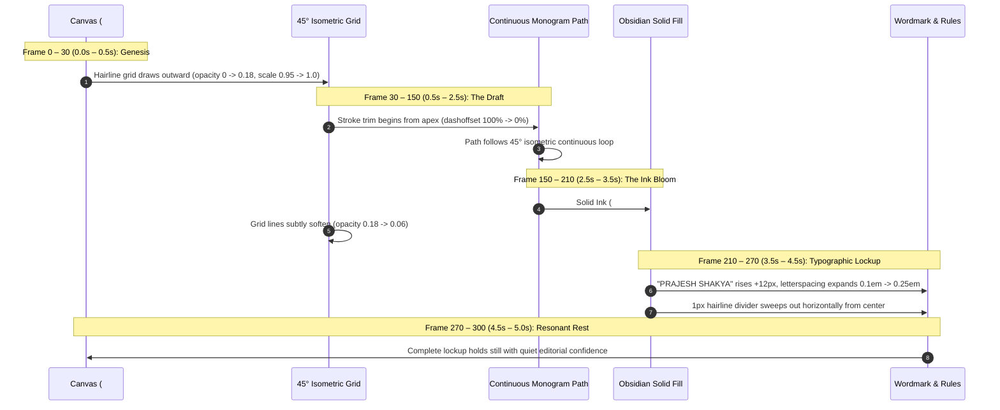

# Prajesh Shakya — Logo Animation Concepts & Kinetic Specification (2026 Edition)

> **"Animation should not decorate the mark; it must reveal the structural logic that brought it into existence."**  
> *A comprehensive kinetic specification for the Prajesh Shakya PS Monogram, detailing motion physics, frame-by-frame choreographies, sound design palettes, and multi-platform implementation.*

---

## 1. Motion Philosophy & The Kinetic Thesis

The PS Monogram is constructed on a strict **45° isometric diamond grid** with a continuous, unbroken path connecting the summit of **'P' (Positioning)** into the counter and spine of **'S' (System)**.

In alignment with the studio's brand DNA (*"Quiet Editorial Confidence"* and *"Honest Physics"*), any animation of this mark must adhere to four non-negotiable rules:

1. **Architectural Truth**: The animation does not treat the mark as a flat graphic to be spun, flipped, or exploded. It treats it as an architectural blueprint being drafted with precision.
2. **Restraint over Spectacle**: No gratuitous particle explosions, neon chromatic aberration, or cartoony bounce easing. Speed curves are steep at the onset and decelerate with luxurious, unhurried poise.
3. **Continuous Path Integrity**: The motion honors the single continuous stroke of the artwork. The eye should intuitively follow the stroke as it loops and weaves.
4. **Editorial Sound Design**: Acoustic, tactile foley (graphite on heavy cotton paper, mechanical shutter clicks, low-frequency linen thud) instead of synthetic electronic whooshes.

---

## 2. Master Motion & Physics Tokens

| Token | Value | Formula / Curve | Usage |
| :--- | :--- | :--- | :--- |
| **Editorial Ease-Out** | `0.6s – 1.8s` | `cubic-bezier(0.16, 1, 0.3, 1)` | Primary stroke deceleration, typographic entrance, scale settling. |
| **Mechanical Snap** | `0.25s – 0.4s` | `cubic-bezier(0.25, 1, 0.5, 1)` | Grid lockup, baseline rule expansion, icon state changes. |
| **Tactile Capillary Fill** | `0.8s` | `cubic-bezier(0.4, 0, 0.2, 1)` | Ink bloom transition from hairline outline to solid obsidian silhouette. |
| **Frame Rate** | `60.0 FPS` | Standard | High-fluidity timeline for video masters and WebGL/SVG rendering. |
| **Reduced Motion** | `0.0s` | `instant cut` | Triggered automatically when `prefers-reduced-motion: reduce` is active. |

---

## 3. Three Production Concepts

```
┌─────────────────────────────────────────────────────────────────────────────┐
│                           THE THREE MOTION ARCHETYPES                       │
├──────────────────────────┬──────────────────────────┬───────────────────────┤
│        CONCEPT 01        │        CONCEPT 02        │      CONCEPT 03       │
│  The Architectural Trace │  The Isometric Continuum │ The Editorial Stamp   │
├──────────────────────────┼──────────────────────────┼───────────────────────┤
│ • Canonical 5.0s Lockup  │ • Dynamic 3.5s Spatial   │ • Micro 1.5s UI Snap  │
│ • Blueprint grid reveal  │ • 3D isometric ribbon    │ • Letterpress impact  │
│ • Continuous line draft  │ • Light sweep on facets  │ • Tactile paper tooth │
│ • Capillary ink bloom    │ • Orthographic 2D snap   │ • Fast web & app hero │
│ • Full wordmark trackout │ • Showreels & case videos│ • Micro-interactions  │
└──────────────────────────┴──────────────────────────┴───────────────────────┘
```

---

### Concept 01: "The Architectural Trace" (Flagship / 5.0 Seconds)

> **The Canonical Identity Lockup**: Designed as the master video opener/closer for case studies, the website hero splash, client presentations, and YouTube/Vimeo monographs.

#### Creative Narrative
We open on serene parchment ground (`#F5F5F3`). A hairline isometric grid emerges from the center, establishing the 45° drafting matrix. A laser-sharp point of deep obsidian ink (`#1B1A16`) begins drafting the continuous stroke of the PS monogram: ascending the diagonal stem, curving through the upper loop of 'P', crossing the central node, and descending into the balanced counter of 'S'. Upon completing the path, the stroke blooms into a solid silhouette, the grid fades into quiet background texture, and the wordmark `PRAJESH SHAKYA` tracks out with typographic gravitas.

#### Frame-by-Frame Timeline (300 Frames @ 60 FPS)



#### Detailed Frame Matrix
- **F000 – F030 (0.00s – 0.50s) | The Grid Origin**:  
  Canvas in pure parchment (`#F5F5F3`). At F010, sixteen 45° diagonal hairline rules (`#D9D7CD`, 0.6pt thickness) stagger into view radiating from center coordinate `(0,0)`. An isometric diamond bounding frame (120×120px) defines the clear space.
- **F030 – F150 (0.50s – 2.50s) | The Stroke Draft**:  
  A single stroke of 2.5pt width begins drawing from the upper vertex of 'P' (`x: 51.83, y: 99.91`). Using `cubic-bezier(0.2, 0.8, 0.2, 1)`, the line travels along the compound SVG path:
  - *F030 – F070*: Traces the upper lobe of 'P'.
  - *F070 – F110*: Crosses the central 45° diagonal junction.
  - *F110 – F150*: Sweeps through the lower 'S' loop and terminal hook.
- **F150 – F210 (2.50s – 3.50s) | The Ink Bloom**:  
  As the tip connects with the origin, the stroke width expands organically while a solid Obsidian Ink fill (`#1B1A16`) fades in with a gentle scale breathing ease (`scale: 0.98 -> 1.00`). The isometric grid dissolves from 18% to 6% opacity.
- **F210 – F270 (3.50s – 4.50s) | Typographic Lockup**:  
  The wordmark `"PRAJESH SHAKYA"` (Instrument Sans Bold, 12pt, uppercase) rises 12px from `opacity: 0` to `opacity: 1`, while its letterspacing expands from `0.10em` to `0.25em`. Simultaneously, the discipline label `"BRAND STRATEGY & IDENTITY"` in Geist Mono (8pt) fades in with a 15-frame delay.
- **F270 – F300 (4.50s – 5.00s) | Resonant Hold**:  
  Full stillness. Zero drift or jitter. The mark commands the frame with absolute authority.

---

### Concept 02: "The Isometric Continuum" (Spatial / 3.5 Seconds)

> **Dynamic Showreel & Video Opener**: Designed for high-energy editorial showreels, client pitch decks, case study launch teasers, and vertical social media cutdowns (9:16).

#### Creative Narrative
Rather than drawing as flat 2D lines, the monogram is treated as an architectural structure extruded in 3D isometric space. The camera glides diagonally across the continuous band as light sweeps across its bevels and cast shadows. As the motion reaches its climax, the camera aligns perpendicular to the 45° isometric axis, snapping the 3D volume seamlessly into the flat graphic silhouette.

#### Key Mechanics
- **3D Isometric Tilt**: Initial camera orientation set to true isometric projection (`yaw: 45°`, `pitch: 35.264°`).
- **Surface Materiality**: Obsidian matte black with micro-chamfered edges reflecting warm gallery ambient light.
- **The Orthographic Collapse (F090 – F150)**: The depth extrusion smoothly shrinks to 0px while the camera field-of-view shifts from perspective to orthographic, transforming spatial architecture into graphic identity.

---

### Concept 03: "The Tactile Editorial Stamp" (Micro UI / 1.5 Seconds)

> **Interactive Web & Mobile Micro-Interaction**: Designed for website page load transitions, mobile MFE splash states, booking confirmations on Cal.com, and email signatures.

#### Creative Narrative
Optimized for zero-lag SVG/CSS and Lottie playback (< 25 KB). Mimics a heavy metal letterpress die striking handmade 300gsm cotton rag paper. Fast, physical, and memorable without obstructing user flow.

#### Key Mechanics
- **F00 – F15 (0.0s – 0.25s)**: Rapid vertical drop from `y: -16px` at `scale: 1.08` to `y: 0px` at `scale: 1.00` with `cubic-bezier(0.16, 1, 0.3, 1)`.
- **F15 – F25 (0.25s – 0.42s)**: Micro-elevation ink rebound (`scale: 1.00 -> 0.99 -> 1.00`) simulating physical paper compression.
- **F25 – F60 (0.42s – 1.00s)**: Wordmark slides in horizontally from left hairline divider.
- **F60 – F90 (1.00s – 1.50s)**: Sits in resting state ready for user interaction.

---

## 4. Acoustic Architecture & Sound Design

A high-craft logo animation requires sound design of equal dignity. The audio palette rejects stock futuristic synths in favor of organic foley:

```
[ LAYER 1: The Tactile Ground ]
  └── Subtle acoustic air and delicate surface tooth of 300gsm cotton rag paper.
[ LAYER 2: The Continuous Trace ]
  └── Organic graphite pencil drafting friction on textured vellum (notched at 2.4 kHz).
[ LAYER 3: The Ink Bloom ]
  └── Warm low-end acoustic thud (analogous to closing a cloth-bound monograph). 60–90 Hz.
[ LAYER 4: The Mechanical Lock ]
  └── Micro-haptic shutter latch (reminiscent of a Leica M viewfinder or Swiss watch movement).
[ LAYER 5: The Resonance ]
  └── Soft, room-tone harmonic ring (decay over 2.5 seconds, pure acoustic warmth).
```

---

## 5. Production Code Implementation Specs

### 1. Web React Component (Framer Motion + SVG)
Available in the codebase at [`components/brand/animated-logo.tsx`](file:///c:/Users/blcne/Documents/GitHub/Prajesh-Portfolio-2026/components/brand/animated-logo.tsx) with three selectable modes, scrub controller, speed multipliers, and theme toggling.

```tsx
import { AnimatedLogo } from "@/components/brand/animated-logo"

// Standard 5-second canonical reveal
<AnimatedLogo mode="trace" autoPlay loop={false} size={140} />

// Micro UI stamp for page loaders
<AnimatedLogo mode="stamp" autoPlay loop={false} size={48} />
```

### 2. Cavalry Scene Generator & Video Renderer
A dedicated procedural scene script is located at [`scripts/cavalry/scenes/scene_logo_animation.js`](file:///c:/Users/blcne/Documents/GitHub/Prajesh-Portfolio-2026/scripts/cavalry/scenes/scene_logo_animation.js).
Rendered directly via Cavalry + FFmpeg into:
- [`Prajesh-Shakya-Logo-Animation.mp4`](file:///c:/Users/blcne/Documents/GitHub/Prajesh-Portfolio-2026/Prajesh-Shakya-Logo-Animation.mp4) (Root)
- [`public/videos/prajesh-shakya-logo-animation.mp4`](file:///c:/Users/blcne/Documents/GitHub/Prajesh-Portfolio-2026/public/videos/prajesh-shakya-logo-animation.mp4) (Public Web)

### 3. Lightweight Lottie Vector Animation
- [`Prajesh-Shakya-Logo.json`](file:///c:/Users/blcne/Documents/GitHub/Prajesh-Portfolio-2026/Prajesh-Shakya-Logo.json) (16.9 KB Bodymovin Lottie JSON)
- [`public/animations/prajesh-shakya-logo.json`](file:///c:/Users/blcne/Documents/GitHub/Prajesh-Portfolio-2026/public/animations/prajesh-shakya-logo.json)

---

## 6. Multi-Platform Delivery Matrix

| Format | Resolution | Codec / Container | Target Destination |
| :--- | :--- | :--- | :--- |
| **Master 4K Video** | `3840 × 2160` (16:9) @ 60 FPS | Apple ProRes 422 HQ / H.264 MP4 | YouTube, Vimeo, Client Case Studies |
| **Social Square** | `2160 × 2160` (1:1) @ 60 FPS | H.265 / H.264 MP4 (High Bitrate) | Instagram Feed, LinkedIn Company Page |
| **Social Vertical** | `1080 × 1920` (9:16) @ 60 FPS | H.264 MP4 | Instagram Reels, YouTube Shorts, Stories |
| **Interactive Web Vector**| Fluid / Scalable Vector | Lottie JSON (< 25 KB) / Bodymovin | Portfolio Hero, Page Transitions |
| **Transparent Alpha** | `1920 × 1080` (16:9) @ 60 FPS | Apple ProRes 4444 with Alpha Channel | Video Overlay Watermark / Lower Third |
